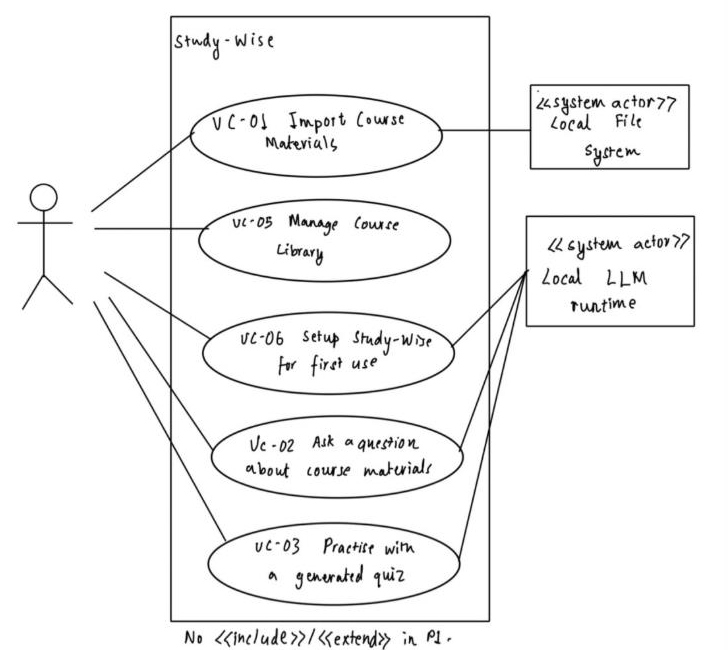

# 3 Specific Requirements

## 3.1 Functional requirements

| ID | Requirement — one "shall" sentence | Priority | Source | Acceptance criterion |
|---|---|---|---|---|
| FR-01 | The system shall import a PDF file selected by the student into a course the student chooses. | MUST | SH1, R7 | Import a 30-page text PDF into course "CS 3354"; the file appears in that course's material list with 30 pages. |
| FR-02 | The system shall import a PowerPoint (.pptx) file selected by the student into a course the student chooses. | MUST | SH1, R7 | Import a 40-slide .pptx; the file appears in the course's material list with 40 slides. |
| FR-03 | The system shall reject an imported file that contains no extractable text with a message naming that file. | SHOULD | A3 | Import an image-only scanned PDF; a message names the file and says no text was found; the file is not listed. |
| FR-04 | The system shall let the student create a course with a name of their choice. | MUST | SH1 | Create course "CS 4349"; it appears in the course list. |
| FR-05 | The system shall keep courses and imported materials available after the application is closed and reopened. | MUST | SH1 | Import a file, close and reopen the application; the file is listed and questions about it are answered without re-importing. |
| FR-06 | The system shall remove a material the student selects so that it is no longer used in answers or quizzes. | SHOULD | SH1 | Remove file X, then ask a question answered only in X; the system reports that no relevant material was found (FR-09). |
| FR-07 | The system shall answer a typed question using only passages from the materials of the course the student selected. | MUST | SH1, R7 | For each of the 20 benchmark questions, every cited source belongs to the selected course. |
| FR-08 | The system shall display with every answer the file name and page or slide number of each passage used. | MUST | SH1 | All 20 benchmark answers show at least one citation; opening each cited page shows the quoted passage. |
| FR-09 | The system shall state that no relevant material was found, instead of answering, when no passage in the selected course matches the question. | MUST | SH1, SH3 | Ask 5 off-topic questions (e.g. "Who won the 2022 World Cup?") in a CS 3354 course; all 5 return the no-material message. |
| FR-10 | The system shall generate a multiple-choice practice quiz of between 1 and 20 questions, as the student chooses, from a selected course. | MUST | SH1, R7 | Request 10 questions; 10 questions appear, each with 4 options of which exactly one is marked correct. |
| FR-11 | The system shall generate short-answer practice questions with a model answer when the student chooses that format. | COULD | R7 | Request 5 short-answer questions; 5 questions appear, each with a model answer and a citation. |
| FR-12 | The system shall limit quiz questions to the materials the student selects within a course. | SHOULD | SH1 | Select only "Lecture 5.pdf"; every generated question cites Lecture 5.pdf. |
| FR-13 | The system shall report the number of correct answers out of the total when the student submits a multiple-choice quiz. | MUST | SH1 | Answer a 10-question quiz with 7 known-correct choices; the system reports 7 / 10. |
| FR-14 | The system shall show for each submitted quiz question the correct answer with its source file and page or slide number. | MUST | SH1 | Submit a quiz; every question shows the correct option plus a citation that opens to the supporting passage. |
| FR-15 | The system shall tell the student, with steps to fix it, when the local LLM runtime is not running or has no model installed. | MUST | SH1, A2 | Stop the runtime, then ask a question; a message says the runtime is not running and lists the steps to start it. |
| FR-16 | The system shall reject a selected file that it cannot open, with a message naming that file. (New, CH-06) | SHOULD | UC-01 A3 | Select a password-protected PDF; a message names the file; the file is not listed. |
| FR-17 | The system shall keep each submitted quiz with its questions, the student's choices and the score, so the student can review it later. (New, CH-20) | SHOULD | Q7 | Submit a 5-question quiz, close and reopen the application; the quiz is listed with its score and each question shows the student's choice and the correct option. |
| FR-18 | The system shall, when the student imports a file whose name matches a material already in the course, ask whether to replace it and, on confirmation, replace the old material. (New, CH-21) | SHOULD | Q8 | Import "Lecture 5.pdf" twice; the second import asks to replace; after confirming, the course lists one "Lecture 5.pdf" and answers cite the new file. |

## 3.2 Quality requirements

| ID | Requirement — with threshold, condition and method | Priority | Source | How it will be verified |
|---|---|---|---|---|
| QR-01 | Performance: 90% of answers shall be fully displayed within 20 seconds of submission on the reference laptop with a model of up to 8B parameters. | SHOULD | SH1, A1 | Scripted run of the 20-question benchmark set; log submit-to-complete time; pass if the 18th-fastest time is ≤ 20 s. S-01 (section 8): met with the 3B model on an 8 GB laptop (18th-fastest 15.1 s); not yet measured on the 16 GB reference laptop (CH-05). Design driver QAS-01. |
| QR-02 | Performance: a 50-page text PDF shall become available for questions within 90 seconds of import on the reference laptop. | SHOULD | SH1 | Import the same 50-page PDF 5 times on a freshly started application; pass if the median time from import to "ready" is ≤ 90 s. Design driver QAS-02. |
| QR-03 | Answer quality: at least 85% of answers to the benchmark set shall be correct and supported by their cited passage. | MUST | SH1, SH3 | Two team members score each answer independently against the answer key and cited page; a third resolves disagreements; pass if ≥ 17 / 20. S-01 saved the 3B answers for this scoring; one reviewer's provisional read is about 13 / 20 (R2). |
| QR-04 | Quiz quality: at least 80% of generated multiple-choice questions shall have exactly one defensible correct option. | MUST | SH1 | Generate 30 questions from 3 different courses' materials; two reviewers judge each independently; pass if ≥ 24 / 30 agreed valid. |
| QR-05 | Usability: 4 of 5 first-time student testers shall import a file and receive a cited answer within 10 minutes without help. | SHOULD | SH1, 2.3 | Moderated session with 5 students not on the team, starting after installation; time to first cited answer, with no hints given. |

## 3.3 Constraint requirements

*Unchanged since v0.6.*

| ID | Constraint — one sentence | Source | Why it cannot be negotiated |
|---|---|---|---|
| CON-01 | The system shall not transmit course materials, questions, answers or quiz content to any destination outside the student's device. | C1; R7; SH2 | Privacy is the reason the product exists; without it Study-Wise is a weaker copy of cloud tools. Checked by capturing network traffic (e.g. Wireshark) during a 30-minute scripted session: no packets from Study-Wise to non-loopback addresses (QAS-03). |
| CON-02 | The system shall operate without any paid service, subscription or API key. | C2; SH1; SH6 | Target users and the team have no budget; a paid dependency would block both use and development. |
| CON-03 | The system shall run on student-owned laptops with Windows 11 or macOS 14 or later and no discrete GPU. | C3; SH1 (assumed, Q2) | Students will not buy hardware to study; a system that needs a GPU excludes most of them. |
| CON-04 | The system shall use only third-party components whose licences permit free use and publication of the project source. | C4; R4; R6; R2 | The course requires an instructor-accessible repository, and a licence violation cannot be fixed after release. |

## 3.4 Initial use cases

Six candidate use cases were drawn; one (UC-04 Take Quiz) was merged into UC-03, leaving the five shown. Each one starts with the student and ends when the student has something of value: materials ready, a library organized, a working setup, an answer, or a scored practice quiz.

UC-01 Import Course Materials · UC-02 Ask a Question About Course Materials · UC-03 Practice with a Generated Quiz · UC-05 Manage Course Library (create courses, remove materials) · UC-06 Set Up Study-Wise for First Use.

**Note on relationships and numbering.** We first drew "Generate Quiz" (UC-03) and "Take Quiz" (UC-04) separately, linked by «include». A generated quiz that is never taken gives the student nothing, so generating a quiz is a step, not a goal. We merged them into UC-03 and retired the number UC-04 so identifiers stay stable. No other «include» or «extend» relationship survived the same test. "Search materials" and "Call model" are steps inside UC-02 and UC-03, not use cases.

UC-01, UC-02 and UC-03 are expanded in section 4 (CH-07).

## 3.5 Requirements to use case traceability

The P1 matrix is extended in section 9.1, and its findings are carried into section 9.2 (CH-07).
